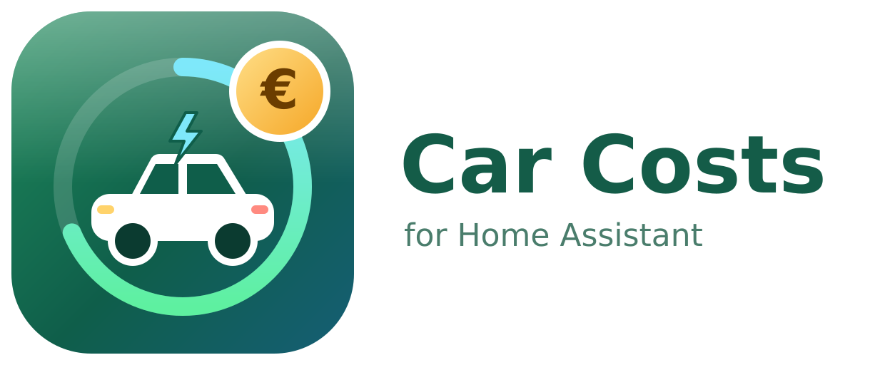
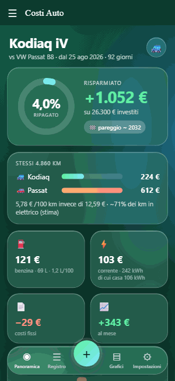
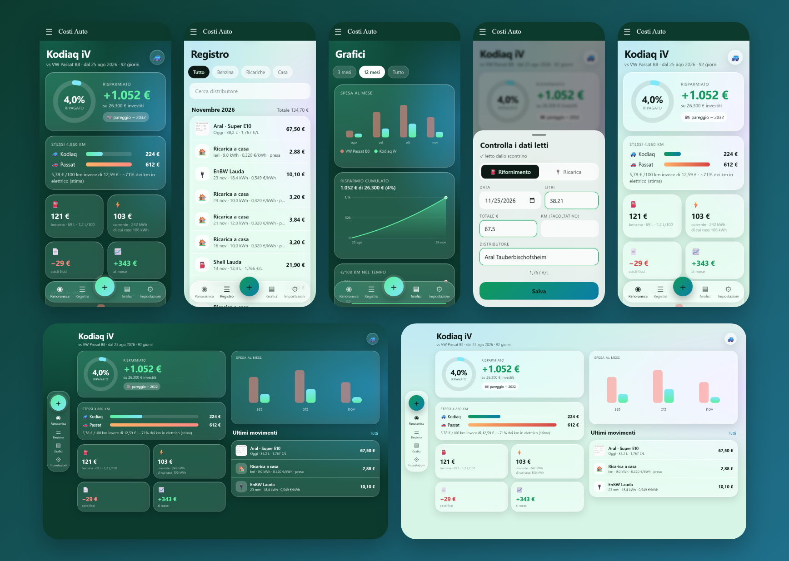

<picture><source media="(prefers-color-scheme: dark)" srcset="docs/images/dark_logo.png"></picture>

<p align="center">
  <a href="https://github.com/EdisonACDC/car-costs/releases"></a>
  <a href="https://analytics.home-assistant.io/custom_integrations.json"></a>
  <br>
  <sub>Die Downloads enthalten auch Updates; aktive Installationen stammen aus Home Assistant Analytics (nur wer die Statistik aktiviert hat).</sub>
</p>

<p align="center">
  <a href="README.md">English</a> · <a href="README.it.md">Italiano</a> · <b>Deutsch</b>
</p>

<p align="center">
  Was kostet dich das neue Auto wirklich – Benzin und Strom – und was hätte das alte für dieselben
  Kilometer gekostet? Car Costs rechnet das jeden Tag aus und sagt dir, wann sich der Kauf bezahlt macht.
</p>

<p align="center">
  <a href="https://github.com/EdisonACDC/car-costs/releases/latest"></a>
  <a href="https://hacs.xyz/"></a>
  <a href="LICENSE"></a>
  <a href="https://ko-fi.com/edisonacdc"></a>
</p>

<p align="center">
  <a href="https://my.home-assistant.io/redirect/hacs_repository/?owner=EdisonACDC&repository=car-costs&category=integration"></a>
</p>

<p align="center">
  
</p>

<p align="center">
  
</p>

## Funktionen

- **Costi Auto im Seitenmenü** von Home Assistant: eine App im „Glas"-Stil für Handy, Tablet und PC, im
  hellen oder dunklen Design von Home Assistant. Kein zweiter Login, kein Add-on.
- **Kilometer** aus dem Kilometerzähler (zum Beispiel die Integration **MySkoda**) oder aus den Tankungen.
- **Haushaltsstrom** vom kWh-Sensor deiner Steckdose oder Wallbox, zum Preis bei dir zu Hause.
- **Tankungen und Ladungen** von Hand, mit den Diensten oder per **Foto des Kassenbons**: eine KI liest
  ihn, du prüfst das ausgefüllte Formular und speicherst. Das Foto bleibt beim Eintrag.
- **Vergleich**: Für jeden Kilometer hätte das alte Auto `Verbrauch × Kraftstoffpreis` gebraucht (fest oder per Sensor).
- **Jährliche Fixkosten** (Steuer, Versicherung, Wartung) beider Autos, auf Tage verteilt.
- **Amortisation**: Investition = Preis + Zusatzkosten − Verkauf des alten Autos; zurückgeholter Anteil und voraussichtliches Datum des Break-even.
- **Diagramme**: Ausgaben pro Monat, kumulierte Ersparnis, €/100 km, Benzin und Strom.
- **Anteil elektrisch gefahrener Kilometer** (Schätzung), wenn du den Stromverbrauch angibst.
- **Handy-Web-App** (installierbar, offline mit der letzten Übersicht) und die Lovelace-Karte `car-costs-card`.
- Italienisch, Deutsch und Englisch, nach der Sprache von Home Assistant.

## Installation

1. **Integration installieren.** Öffne in HACS **⋮ → Benutzerdefinierte Repositories**, füge
   `https://github.com/EdisonACDC/car-costs` als **Integration** hinzu, installiere **Car Costs** und starte
   Home Assistant neu.
2. **Hinzufügen.** Gehe zu **Einstellungen → Geräte & Dienste → Integration hinzufügen → Car Costs** und
   folge den vier Schritten.
3. **„Costi Auto" öffnen**, im Seitenmenü. Das Panel erscheint von selbst.

> **Achte auf den Namen im Marketplace.** Wenn weitere Projekte namens „Car Costs" auftauchen, wähle das
> vom Typ **Integration**, von **EdisonACDC**.

## Konfiguration

Die Einrichtung hat vier kurze Schritte; alles lässt sich später unter **Einstellungen → Geräte & Dienste → Car Costs → Konfigurieren** ändern.

1. **Auto**: Name, Kaufpreis, Zusatzkosten (Wallbox, Zulassung …), Lieferdatum, Kilometerstand bei Lieferung,
   Kilometer-Sensor (optional) und ob **„Costi Auto" im Seitenmenü angezeigt** wird.
2. **Strom und Bons**: Strompreis zu Hause (oder ein Preis-Sensor), der kWh-Sensor der Steckdose oder
   Wallbox, der Stromverbrauch (kWh/100 km, optional) und die **AI-Task**-Entität, die Bons liest.
3. **Vergleichsauto**: das alte Auto, sein Kraftstoff, Verbrauch, Kraftstoffpreis (oder ein Sensor) und Verkaufspreis.
4. **Jahreskosten**: Steuer, Versicherung und Wartung beider Autos.

Bei mehreren Autos fügst du die Integration einmal pro Auto hinzu; Panel und App bieten eine Auto-Auswahl.

## KI für Kassenbons

Fotografiere den Bon mit **＋ → 📷 Beleg**: Das Foto geht an die **AI-Task**-Entität, die du gewählt hast,
und sie liefert Datum, Tankstelle, Liter oder kWh und Summe. Du siehst das ausgefüllte Formular, fehlende
Felder sind rot, und drückst **Speichern**.

- **Kostenlos**: Google Gemini, mit einem kostenlosen Schlüssel aus [Google AI Studio](https://aistudio.google.com/apikey),
  hinzugefügt über die Home-Assistant-Integration *Google Generative AI*.
- Auch **OpenAI**, **Anthropic** oder **Ollama** mit einem Vision-Modell.
- **Was gesendet wird**: nur das Foto des Bons und die Anweisung, ihn zu lesen. Sonst nichts aus deinem
  Zuhause. Das Foto bleibt in `/media/car_costs` und wird mit dem Eintrag gelöscht; Fotos, die in
  keinem Eintrag landen, werden nach 24 Stunden gelöscht.
- Ohne KI bittet dich die App, das Formular von Hand auszufüllen.

## Web-App auf dem Handy

Dieselbe App fürs Handy, außerhalb der Home-Assistant-App: Öffne `https://<dein-home-assistant>/car-costs`
(auch eine Nabu-Casa-Adresse funktioniert), melde dich mit deinem Home-Assistant-Benutzer an und füge sie dem Home-Bildschirm hinzu:

- **iPhone**: Safari → Teilen → *Zum Home-Bildschirm*
- **Android**: Chrome → ⋮ → *App installieren*

Sie funktioniert auch nur im lokalen Netz, und die letzte Übersicht bleibt offline verfügbar. Bei mehreren Autos:
`/car-costs?entry=<config_entry_id>`.

## Dienste

| Dienst | Felder |
|---|---|
| `car_costs.add_refuel` | `liters`, `total_cost`, `odometer`, `date`, `station`, `note` |
| `car_costs.add_charge` | `kwh`, `total_cost` (leer zu Hause = Hauspreis), `location` home/public |
| `car_costs.scan_receipt` | `image` (Medien oder Dateipfad), `auto_add` |
| `car_costs.update_entry` | `entry_id` + die zu ändernden Felder |
| `car_costs.delete_entry` | `entry_id` (löscht auch das Foto) |

Das Ereignis `car_costs_receipt_scanned` wird nach jedem Bon ausgelöst (praktisch für eine Benachrichtigung).

## Karte

Die Lovelace-Karte wird von der Integration geladen, es ist keine Ressource hinzuzufügen:

```yaml
type: custom:car-costs-card
# config_entry_id: ...   # nur wenn du mehrere Autos verfolgst
# limit: 15
```

## FAQ

**Brauche ich eine Wallbox oder eine smarte Steckdose?** Nein. Ohne sie trägst du die Ladungen zu Hause von
Hand ein. Mit einem kWh-Sensor werden sie automatisch gezählt, von Hand gibst du dann nur Ladungen
außer Haus ein.

**Brauche ich MySkoda?** Nein. Jeder Sensor mit dem Kilometerstand genügt; ohne ihn kommen die Kilometer aus den Tankungen.

**Brauche ich die KI?** Nein, sie liest nur Fotos von Bons. Alles lässt sich von Hand eingeben.

**Brauche ich ein Add-on?** Nein. Auch der Supervisor ist nicht nötig.

**Wo liegen meine Daten?** Im Speicher von Home Assistant (eine Datei pro Auto) und, für Fotos, in
`/media/car_costs`. Nichts verlässt dein Zuhause, außer dem Foto des Bons, das du an die gewählte KI sendest.

**Und der Verlauf?** Jede Nacht wird eine Momentaufnahme der Summen gespeichert (bis zu 5 Jahre): Die Diagramme brauchen sie.

**Funktioniert es in anderen Sprachen?** Italienisch, Deutsch und Englisch, nach der Sprache von Home Assistant.

## Stand und Grenzen

- Getestet mit den automatischen Tests (pytest auf einem Test-Home-Assistant) und, für Panel und App, in
  einem Browser gegen einen **simulierten** Home Assistant. Noch zu prüfen auf einer echten Installation:
  das Panel im Frontend von Home Assistant (Menü-Knopf, Design, Sprache), die Kamera und die KI beim Lesen
  echter Bons auf dem Handy, und wie sich die Zahlen über mehrere Wochen verhalten.
- In den ersten Wochen schwanken die Zahlen: Das Benzin des neuen Autos wird beim Tanken gezählt, die
  Kosten des alten pro gefahrenem Kilometer.
- Autos, Tankstellen und Beträge in den Screenshots sind erfunden.

## Unterstützung

Wenn dir Car Costs hilft, kannst du mir einen Kaffee spendieren ☕ [ko-fi.com/edisonacdc](https://ko-fi.com/edisonacdc)

Und gib dem Repo gern einen ⭐ – das hilft anderen, es zu finden.

## Entwicklung

```bash
python -m venv .venv
. .venv/bin/activate
pip install -r requirements_test.txt
pytest
ruff check . && ruff format --check .
mypy
```

App und Panel im Browser, gegen einen simulierten Home Assistant (Node.js):

```bash
cd tools/e2e
npm install && npx playwright install chromium
node run.mjs          # Prüfungen und Screenshots
node make_docs.mjs    # Bilder für die README
```

## Lizenz

MIT, siehe [LICENSE](LICENSE). Änderungen: [CHANGELOG.md](CHANGELOG.md).
