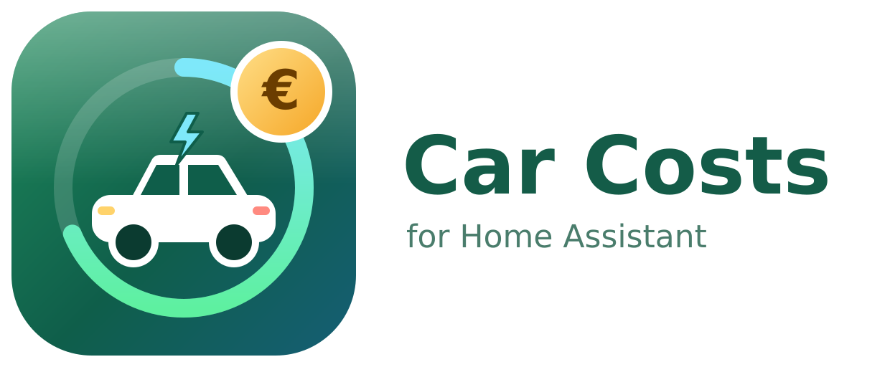
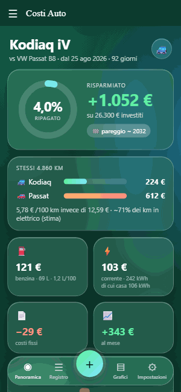
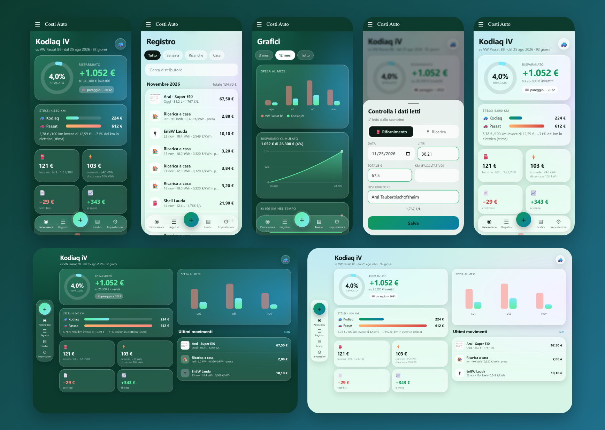

<p align="center"><picture><source media="(prefers-color-scheme: dark)" srcset="docs/images/dark_logo.png"></picture></p>

<p align="center">
  <a href="https://github.com/EdisonACDC/car-costs/releases"></a>
  <a href="https://analytics.home-assistant.io/custom_integrations.json"></a>
  <br>
  <sub>I download comprendono anche gli aggiornamenti; le installazioni attive vengono da Home Assistant Analytics (solo chi ha attivato le statistiche).</sub>
</p>

<p align="center">
  <a href="README.md">English</a> · <b>Italiano</b> · <a href="README.de.md">Deutsch</a>
</p>

<p align="center">
  Quanto ti costa davvero la nuova auto (benzina + corrente) e quanto avresti speso con la vecchia per
  gli stessi km? Car Costs lo calcola ogni giorno e ti dice quando l'acquisto si ripaga.
</p>

<p align="center">
  <a href="https://github.com/EdisonACDC/car-costs/releases/latest"></a>
  <a href="https://hacs.xyz/"></a>
  <a href="LICENSE"></a>
  <a href="https://ko-fi.com/edisonacdc"></a>
</p>

<p align="center">
  <a href="https://my.home-assistant.io/redirect/hacs_repository/?owner=EdisonACDC&repository=car-costs&category=integration"></a>
</p>

<p align="center">
  
</p>

<p align="center">
  
</p>

## Cosa fa

- **Costi Auto nel menu laterale** di Home Assistant: un'app in stile "vetro" che si adatta a telefono,
  tablet e PC, con il tema chiaro o scuro di Home Assistant. Nessun secondo login, nessun add-on.
- **Km** letti dal contachilometri (per esempio l'integrazione **MySkoda**) o dai rifornimenti.
- **Corrente di casa** dal sensore kWh della presa o della wallbox, al prezzo di casa.
- **Rifornimenti e ricariche** a mano, con i servizi, oppure da una **foto dello scontrino**: un'AI lo
  legge, controlli il modulo già compilato e salvi. La foto resta con la voce.
- **Confronto**: per ogni km la vecchia auto consumerebbe `consumo × prezzo carburante` (fisso o da sensore).
- **Costi fissi** annuali (bollo, assicurazione, manutenzione) di entrambe, ripartiti per giorno.
- **Ammortamento**: investimento = prezzo + spese extra − vendita della vecchia auto; % recuperata e data di pareggio prevista.
- **Grafici**: spesa al mese, risparmio cumulato, €/100 km, benzina e corrente.
- **Quota di km in elettrico** (stima), se indichi il consumo elettrico.
- **Web app per il telefono** (installabile, funziona offline con l'ultimo riepilogo) e la card Lovelace `car-costs-card`.
- Italiano, tedesco e inglese, dalla lingua di Home Assistant.

## Installazione

1. **Installa l'integrazione.** In HACS apri **⋮ → Repository personalizzati**, aggiungi
   `https://github.com/EdisonACDC/car-costs` come **Integrazione**, installa **Car Costs** e riavvia
   Home Assistant.
2. **Aggiungila.** Vai in **Impostazioni → Dispositivi e servizi → Aggiungi integrazione → Car Costs** e
   segui i quattro passi.
3. **Apri "Costi Auto"** dal menu laterale. Il pannello compare da solo.

> **Occhio al nome nel Marketplace.** Se compaiono altri progetti chiamati "Car Costs", scegli quello di
> tipo **Integrazione**, di **EdisonACDC**.

## Configurazione

Il setup ha quattro passi brevi; tutto si può cambiare dopo da **Impostazioni → Dispositivi e servizi → Car Costs → Configura**.

1. **Auto**: nome, prezzo d'acquisto, spese extra (wallbox, immatricolazione…), data di consegna, km alla
   consegna, sensore dei km (facoltativo) e se **mostrare "Costi Auto" nel menu laterale**.
2. **Corrente e scontrini**: prezzo di casa (o un sensore del prezzo), il sensore kWh della presa o della
   wallbox, il consumo elettrico (kWh/100 km, facoltativo) e l'entità **AI Task** che legge gli scontrini.
3. **Auto con cui confrontare**: la vecchia auto, il suo carburante, consumo, prezzo del carburante (o un sensore) e prezzo di vendita.
4. **Costi annuali**: bollo, assicurazione e manutenzione di entrambe.

Con più auto aggiungi l'integrazione una volta per auto; il pannello e l'app offrono il selettore dell'auto.

## AI per gli scontrini

Fotografa lo scontrino con **＋ → 📷 Scontrino**: la foto va all'entità **AI Task** che hai scelto, che
restituisce data, distributore, litri o kWh e totale. Vedi il modulo già compilato, con i campi
mancanti in rosso, e premi **Salva**.

- **Gratis**: Google Gemini, con una chiave gratuita da [Google AI Studio](https://aistudio.google.com/apikey),
  aggiunta con l'integrazione *Google Generative AI* di Home Assistant.
- Anche **OpenAI**, **Anthropic** oppure **Ollama** con un modello vision.
- **Cosa si manda**: solo la foto dello scontrino e l'istruzione di leggerlo. Nient'altro della tua casa.
  La foto resta in `/media/car_costs` e si cancella con la voce; le foto che non finiscono in nessuna
  voce si cancellano dopo 24 ore.
- Senza AI l'app ti chiede di compilare il modulo a mano.

## App sul telefono

Il telefono **non** ha bisogno di un account di Home Assistant e non vede mai il login di Home Assistant. Lo si collega dal pannello, come Family Hub fa con gli invitati:

1. In **Costi Auto → Impostazioni → App sul telefono** premi **Collega un telefono**. Dagli un nome (per esempio "iPhone Marius"), scegli le auto visibili e i permessi: *Solo vedere*, *Vedere e aggiungere*, oppure *Vedere, aggiungere e modificare*.
2. Compare un **QR code** (con **Copia** e **Condividi**). Inquadralo col telefono. Il link vale una volta sola e per 24 ore; il codice sta dopo il `#` dell'indirizzo, quindi non finisce in nessun log.
3. Il telefono lo scambia con un token suo (256 bit, in Home Assistant solo come hash SHA-256, rinnovato ogni 30 giorni) e apre l'app. Basta.

- **iPhone:** se il link si apre in Safari, l'app spiega: Condividi → *Aggiungi alla schermata Home*, poi apri l'icona. Il collegamento è già dentro.
- **Android:** Chrome → ⋮ → *Installa app*.
- I **telefoni collegati** sono nell'elenco del pannello (nome, ultimo accesso, permessi). Puoi rinominarne uno, cambiare permessi e auto, scollegarlo (smette subito) o collegare un *nuovo telefono* al suo posto.
- Il telefono riceve solo le auto e le azioni che gli hai dato, da `/api/car_costs/app/…`. Non riceve mai entità, configurazione o altro di Home Assistant. Le richieste sono limitate per telefono e per indirizzo, e un indirizzo si blocca dopo 10 attivazioni sbagliate.
- Senza un indirizzo esterno (Nabu Casa o URL esterno di Home Assistant) il pannello avvisa che il link funziona solo in casa. L'ultimo riepilogo resta disponibile offline.

## Servizi

| Servizio | Campi |
|---|---|
| `car_costs.add_refuel` | `liters`, `total_cost`, `odometer`, `date`, `station`, `note` |
| `car_costs.add_charge` | `kwh`, `total_cost` (vuoto a casa = prezzo di casa), `location` home/public |
| `car_costs.scan_receipt` | `image` (media o percorso file), `auto_add` |
| `car_costs.update_entry` | `entry_id` + i campi da cambiare |
| `car_costs.delete_entry` | `entry_id` (cancella anche la foto) |

L'evento `car_costs_receipt_scanned` parte dopo ogni scontrino (utile per una notifica).

## Card

La card Lovelace viene caricata dall'integrazione, non c'è nessuna risorsa da aggiungere:

```yaml
type: custom:car-costs-card
# config_entry_id: ...   # solo se segui più auto
# limit: 15
```

## FAQ

**Serve la wallbox o una presa smart?** No. Senza, inserisci a mano le ricariche di casa. Con un sensore
kWh sono contate da sole, quindi a mano inserisci solo quelle fuori casa.

**Serve MySkoda?** No. Va bene qualsiasi sensore con i km; senza, i km vengono dai rifornimenti.

**Serve l'AI?** No, serve solo a leggere le foto degli scontrini. Tutto si può inserire a mano.

**Serve un add-on?** No. Non serve nemmeno il Supervisor.

**Dove sono i miei dati?** Nell'archivio di Home Assistant (un file per auto) e, per le foto, in
`/media/car_costs`. Nulla esce da casa tua, tranne la foto dello scontrino che mandi all'AI scelta.

**E lo storico?** Ogni notte si salva uno snapshot dei totali (fino a 5 anni): servono ai grafici.

**Funziona in altre lingue?** Italiano, tedesco e inglese, dalla lingua di Home Assistant.

## Stato e limiti

- Provato con i test automatici (pytest su un Home Assistant di prova) e, per pannello e app, in un browser
  contro un Home Assistant **simulato**. Da verificare su un'installazione vera: il pannello dentro il
  frontend di Home Assistant (pulsante menu, tema, lingua), la fotocamera e l'AI che legge scontrini
  veri da telefono, e come si comportano i numeri dopo qualche settimana.
- Nelle prime settimane i numeri oscillano: la benzina della nuova auto è contata quando fai il pieno, il
  costo della vecchia per km percorso.
- Auto, distributori e importi negli screenshot sono inventati.

## Sostienimi

Se Car Costs ti è utile, puoi offrirmi un caffè ☕ [ko-fi.com/edisonacdc](https://ko-fi.com/edisonacdc)

E metti una ⭐ al repo: aiuta altri a trovarlo.

## Sviluppo

```bash
python -m venv .venv
. .venv/bin/activate
pip install -r requirements_test.txt
pytest
ruff check . && ruff format --check .
mypy
```

App e pannello in un browser, contro un Home Assistant simulato (Node.js):

```bash
cd tools/e2e
npm install && npx playwright install chromium
node run.mjs          # controlli e screenshot
node make_docs.mjs    # immagini del README
```

## Licenza

MIT, vedi [LICENSE](LICENSE). Modifiche: [CHANGELOG.md](CHANGELOG.md).
