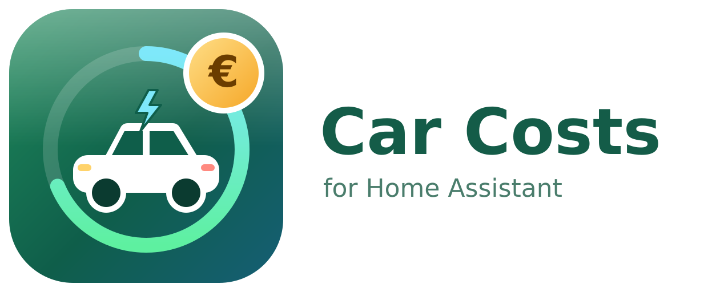
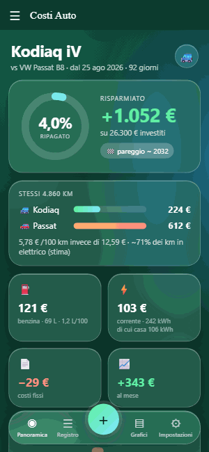
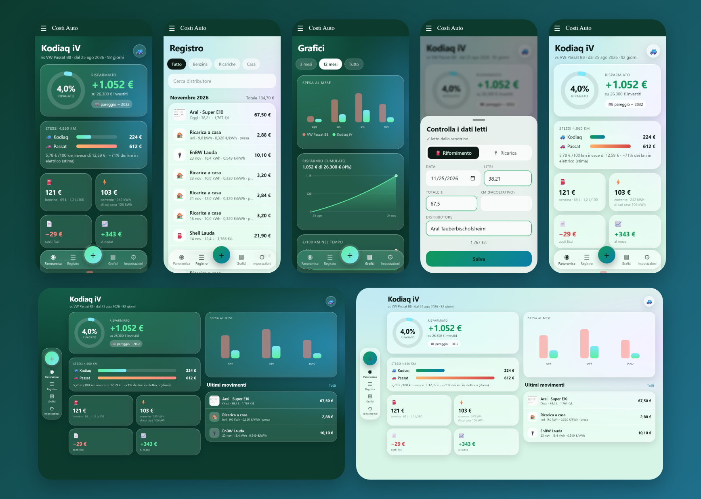

<picture><source media="(prefers-color-scheme: dark)" srcset="docs/images/dark_logo.png"></picture>

<p align="center">
  <a href="https://github.com/EdisonACDC/car-costs/releases"></a>
  <a href="https://analytics.home-assistant.io/custom_integrations.json"></a>
  <br>
  <sub>Downloads also include updates; active installations come from Home Assistant Analytics (only people who turned on analytics).</sub>
</p>

<p align="center">
  <b>English</b> · <a href="README.it.md">Italiano</a> · <a href="README.de.md">Deutsch</a>
</p>

<p align="center">
  What does your new car really cost – petrol and electricity – and what would the old one have cost
  for the same kilometres? Car Costs works it out every day and tells you when the purchase pays for itself.
</p>

<p align="center">
  <a href="https://github.com/EdisonACDC/car-costs/releases/latest"></a>
  <a href="https://hacs.xyz/"></a>
  <a href="LICENSE"></a>
  <a href="https://ko-fi.com/edisonacdc"></a>
</p>

<p align="center">
  <a href="https://my.home-assistant.io/redirect/hacs_repository/?owner=EdisonACDC&repository=car-costs&category=integration"></a>
</p>

<p align="center">
  
</p>

<p align="center">
  
</p>

## Features

- **Costi Auto in the side menu** of Home Assistant: a "glass" app that fits phone, tablet and PC, in the
  light or dark theme of Home Assistant. No second login, no add-on.
- **Kilometres** from the odometer (for example the **MySkoda** integration) or from the refuels.
- **Home electricity** from the kWh sensor of your plug or wallbox, at the price of your home.
- **Refuels and charges** by hand, with the services, or from a **photo of the receipt**: an AI reads it,
  you check the filled-in form and save. The photo stays with the entry.
- **Comparison**: for each kilometre, the old car would have used `consumption × fuel price` (fixed, or from a sensor).
- **Yearly fixed costs** (tax, insurance, maintenance) of both cars, spread per day.
- **Payback**: investment = price + extra costs − sale of the old car; share recovered and expected break-even date.
- **Charts**: monthly spending, cumulative savings, €/100 km, petrol and electricity.
- **Share of electric kilometres** (estimate), if you give the electric consumption.
- **Phone web app** (installable, works offline with the last summary) and the Lovelace card `car-costs-card`.
- Italian, German and English, from the Home Assistant language.

## Installation

1. **Install the integration.** In HACS, open **⋮ → Custom repositories**, add
   `https://github.com/EdisonACDC/car-costs` as an **Integration**, install **Car Costs**, then restart
   Home Assistant.
2. **Add it.** Go to **Settings → Devices & services → Add integration → Car Costs** and follow the four steps.
3. **Open "Costi Auto"** from the side menu. The panel appears by itself.

> **Mind the name in the Marketplace.** If other projects called "Car Costs" show up, choose the one of
> type **Integration**, by **EdisonACDC**.

## Configuration

The setup has four short steps; everything can be changed later from **Settings → Devices & services → Car Costs → Configure**.

1. **Car**: name, purchase price, extra costs (wallbox, registration…), delivery date, odometer at delivery,
   odometer sensor (optional) and whether to **show "Costi Auto" in the side menu**.
2. **Electricity and receipts**: price at home (or a price sensor), the kWh sensor of the plug or wallbox,
   the electric consumption (kWh/100 km, optional) and the **AI Task** entity that reads receipts.
3. **Car to compare with**: the old car, its fuel, consumption, fuel price (or a sensor) and sale price.
4. **Yearly costs**: tax, insurance and maintenance of both cars.

With several cars, add the integration once per car; the panel and the app offer a car selector.

## AI for receipts

Photograph the receipt with **＋ → 📷 Receipt**: the photo goes to the **AI Task** entity you chose, which
returns the date, station, litres or kWh and total. You see the form already filled in, with red fields
for anything missing, and press **Save**.

- **Free option**: Google Gemini, with a free key from [Google AI Studio](https://aistudio.google.com/apikey),
  added through Home Assistant's *Google Generative AI* integration.
- Also **OpenAI**, **Anthropic**, or **Ollama** with a vision model.
- **What is sent**: only the photo of the receipt and the instruction to read it. Nothing else from your
  home. The photo stays in `/media/car_costs` and is deleted with the entry; photos that end up in no
  entry are deleted after 24 hours.
- Without an AI the app asks you to fill in the form by hand.

## Phone web app

The same app, for the phone, outside Home Assistant's own app: open `https://<your-home-assistant>/car-costs`
(a Nabu Casa address works too), sign in with your Home Assistant user, and add it to the Home screen:

- **iPhone**: Safari → Share → *Add to Home Screen*
- **Android**: Chrome → ⋮ → *Install app*

It works on the local network alone, and the last summary stays available offline. With several cars:
`/car-costs?entry=<config_entry_id>`.

## Services

| Service | Fields |
|---|---|
| `car_costs.add_refuel` | `liters`, `total_cost`, `odometer`, `date`, `station`, `note` |
| `car_costs.add_charge` | `kwh`, `total_cost` (empty at home = home price), `location` home/public |
| `car_costs.scan_receipt` | `image` (media or file path), `auto_add` |
| `car_costs.update_entry` | `entry_id` + the fields to change |
| `car_costs.delete_entry` | `entry_id` (also deletes the photo) |

The event `car_costs_receipt_scanned` fires after every receipt (handy for a notification).

## Card

The Lovelace card is loaded by the integration, nothing to add as a resource:

```yaml
type: custom:car-costs-card
# config_entry_id: ...   # only if you follow several cars
# limit: 15
```

## FAQ

**Do I need a wallbox or a smart plug?** No. Without it, enter the home charges by hand. With a kWh sensor
they are counted automatically, so by hand you only enter charges away from home.

**Do I need MySkoda?** No. Any sensor with the odometer works, and without one the kilometres come from the refuels.

**Do I need the AI?** No, it only reads receipt photos. Everything can be entered by hand.

**Do I need an add-on?** No. No Supervisor is needed either.

**Where is my data kept?** In Home Assistant's own storage (one file per car) and, for photos, in
`/media/car_costs`. Nothing leaves your home except the receipt photo you send to the AI you chose.

**What happens to the history?** Every night a snapshot of the totals is saved (up to 5 years): the charts use it.

**Does it work in other languages?** Italian, German and English, from the Home Assistant language.

## Status and limits

- Tested with the automated tests (pytest on a test Home Assistant) and, for the panel and the app, in a
  browser against a **simulated** Home Assistant. Still to check on a real installation: the panel inside
  Home Assistant's own frontend (menu button, theme, language), the camera and the AI reading real
  receipts on a phone, and how the numbers behave over several weeks.
- In the first weeks the figures move a lot: the new car's petrol is counted when you fill up, the old
  car's cost per kilometre driven.
- The cars, stations and amounts in the screenshots are invented.

## Support

If Car Costs helps you, you can buy me a coffee ☕ [ko-fi.com/edisonacdc](https://ko-fi.com/edisonacdc)

And please ⭐ the repo – it helps others find it.

## Development

```bash
python -m venv .venv
. .venv/bin/activate
pip install -r requirements_test.txt
pytest
ruff check . && ruff format --check .
mypy
```

App and panel in a browser, against a simulated Home Assistant (Node.js):

```bash
cd tools/e2e
npm install && npx playwright install chromium
node run.mjs          # checks and screenshots
node make_docs.mjs    # README pictures
```

## License

MIT, see [LICENSE](LICENSE). Changes: [CHANGELOG.md](CHANGELOG.md).
